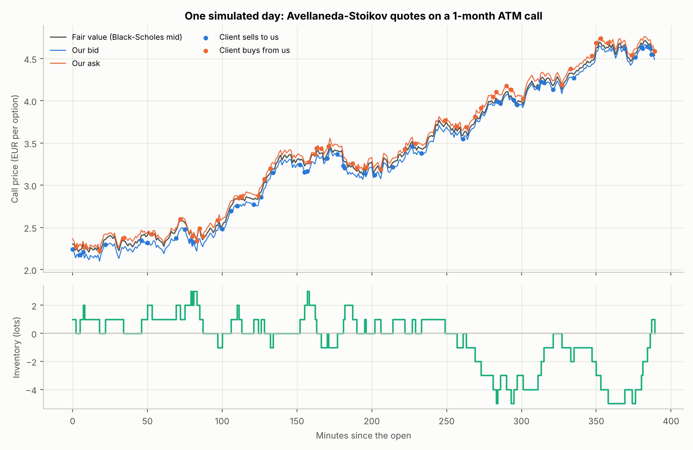
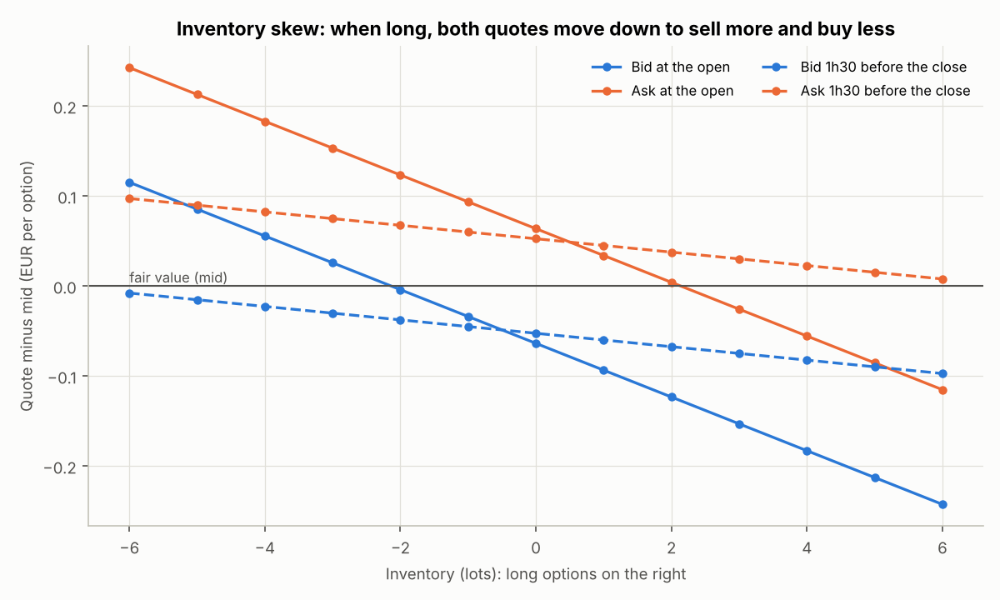
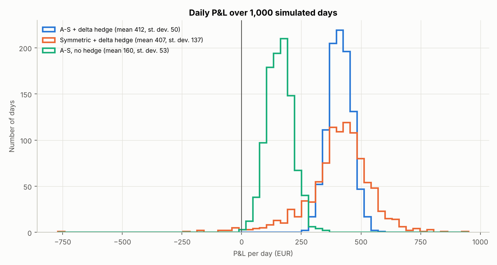
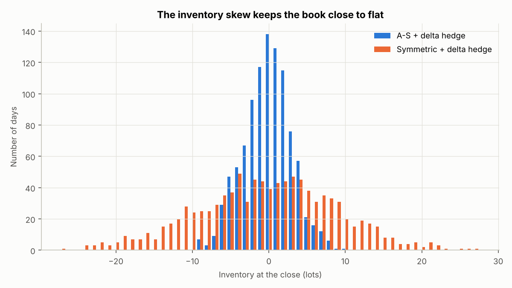
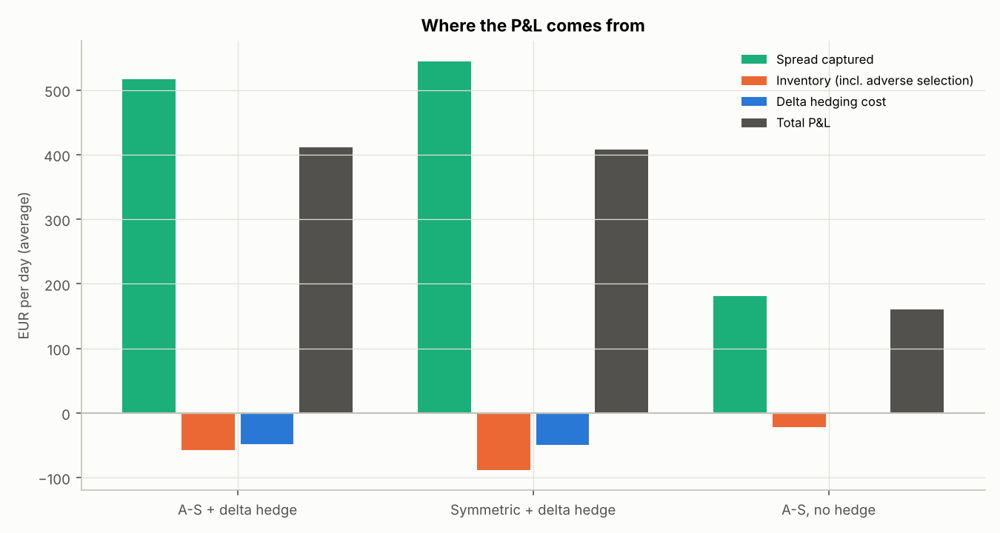
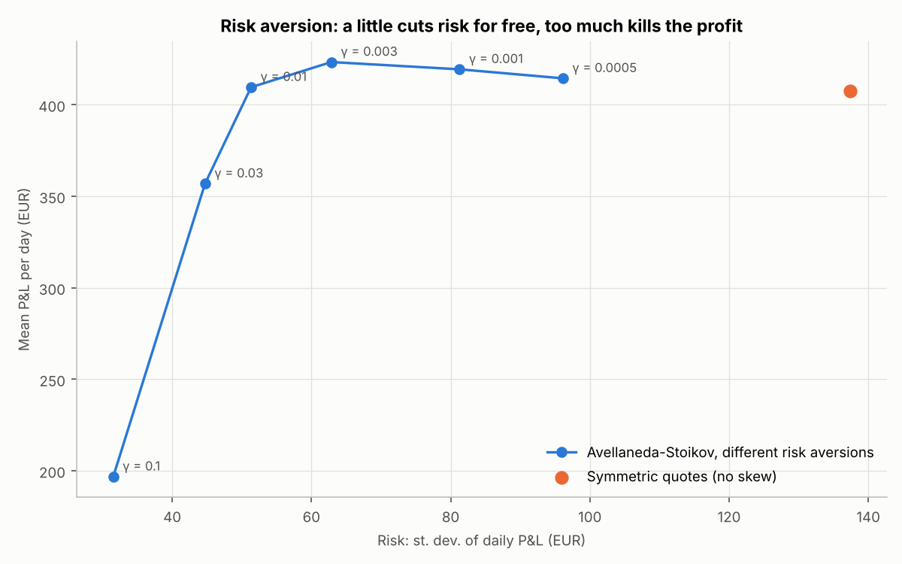

# Options Market Making with the Avellaneda-Stoikov Model

A market maker on an options exchange shows a **bid and an ask on the same option
all day long**. It does not bet on the market: it wants to earn the spread between
the two prices, many times a day. The danger is **inventory**. If clients keep
selling it the same option, it ends up with a big position it never wanted.

In this project I simulate a market maker quoting a **1-month at-the-money call** on
a stock, and I compare three ways of quoting. The quotes come from the
**Avellaneda-Stoikov model (2008)**, the standard starting point for market making
on electronic trading desks.

**The data is simulated.** Market makers' order flow is not public, so I built a
simple market where clients arrive at random. Each strategy sees exactly the same
1,000 simulated days, so the comparison is fair.



## 1. The setup

| Parameter | Value |
|---|---|
| Option | Call, strike 100, maturity 1 month, stock at 100 |
| Implied vol | 20%, moves by 1.5 vol points per day (random walk) |
| Option price | Black-Scholes, about EUR 2.30 per option |
| Trade size | 1 lot = 100 options |
| One day | 390 minutes, quotes updated every minute |
| Clients | about 150 trades per day on each side if we quoted at the mid, fewer as we quote wider |
| Adverse selection | after a client buys, implied vol goes up 0.1 point (and down after a client sells) |
| Delta hedge cost | 1 bp of the stock amount traded |

The client flow follows the model in the paper: the chance of being hit falls
exponentially with the distance between our quote and the fair value. A tight quote
trades a lot but earns little per trade. A wide quote earns more per trade but
rarely trades.

**Adverse selection** is what makes market making hard in practice. Some clients know
something, or their flow moves the market. After you sell them an option, the price
tends to go up. I model it in the simplest way: every client trade moves implied
vol 0.1 point against the market maker.

## 2. The Avellaneda-Stoikov quotes

The model gives two formulas. With *q* the inventory (in lots), *γ* the risk aversion,
*σ* the volatility of the price we are exposed to and *T − t* the time left in the day:

**Reservation price** (the price at which we are happy to hold our inventory):

r = mid − q × γ × σ² × (T − t)

**Spread** (the distance between our bid and our ask):

spread = γ × σ² × (T − t) + (2 / γ) × ln(1 + γ / k)

Then **bid = r − spread / 2** and **ask = r + spread / 2**.

In plain words:

- **If we are long, we lower both quotes.** A lower ask makes clients buy from us
  more often, and a lower bid makes them sell to us less often. The inventory goes
  back towards zero. If we are short, we do the opposite.
- **The more risk, the bigger the skew.** The shift grows with the inventory, with
  the volatility of the option and with the time left before the close.
- **The spread mostly depends on k**, how quickly clients disappear when we quote
  wider. Here it is about EUR 0.11 per option, roughly 1 vol point wide.



**What changes for an option?** The formulas were written for a stock. For an option,
the key question is what *σ* is. If the market maker **delta-hedges** with the stock
after each trade, the stock risk disappears and only the **vega risk** is left
(the risk that implied vol moves). So:

- delta-hedged: σ = vega × vol of vol, about EUR 17 per lot per day,
- not hedged: σ also includes the delta risk, about EUR 67 per lot per day.

This is the idea of Stoikov and Sağlam (2009): an options market maker hedges the
delta and manages its vega inventory.

## 3. Results: three strategies over 1,000 days

1. **A-S + delta hedge**: Avellaneda-Stoikov quotes, delta hedged after every trade.
2. **Symmetric + delta hedge**: same spread, but always centred on the mid (no inventory skew).
3. **A-S, no hedge**: Avellaneda-Stoikov quotes, no delta hedge.

| Per day, EUR | A-S + delta hedge | Symmetric + delta hedge | A-S, no hedge |
|---|---|---|---|
| Mean P&L | **412** | 407 | 160 |
| Standard deviation | **50** | 137 | 53 |
| P&L / risk | **8.3** | 3.0 | 3.0 |
| Worst day | **+259** | −771 | −7 |
| Losing days | **0%** | 1.4% | 0.2% |
| Trades per day | 104 | 98 | 35 |
| Average inventory at the close (lots) | 2.4 | 7.2 | 1.2 |
| Average max inventory in the day (lots) | 4.4 | 11.0 | 2.0 |



**Finding 1: the inventory skew cuts the risk by almost three times, for free.**
Both delta-hedged strategies make about the same money (EUR 412 vs 407 per day),
because they quote the same spread. But without the skew the inventory drifts
(up to 11 lots in a day on average), and a big vega position can lose a lot when
implied vol moves: the worst day is −771. With the skew the book stays close to
flat and **the worst day is still a profit**.



**Finding 2: delta hedging lets you quote tighter and trade three times more.**
Without the hedge, the market maker carries the stock risk too. The model sees a
much bigger σ and widens the quotes, so clients trade only 35 times a day instead
of 104. The risk is similar but the P&L is 2.6 times smaller. Hedging costs about
EUR 48 per day, which is small compared to the extra spread earned.

**Finding 3: the spread pays, the inventory costs.** Almost all the money comes
from the spread captured (about EUR 5 per lot traded). The inventory line is
negative on average because of adverse selection: clients' trades move the price
against us.



## 4. Risk aversion γ

| γ | Mean P&L / day | St. dev. / day | Trades / day | Max inventory (lots) |
|---|---|---|---|---|
| 0.0005 | 414 | 96 | 109 | 9.1 |
| 0.001 | 419 | 81 | 108 | 8.0 |
| 0.003 | 423 | 63 | 107 | 6.1 |
| **0.01 (base case)** | 410 | 51 | 103 | 4.4 |
| 0.03 | 357 | 45 | 93 | 3.3 |
| 0.1 | 197 | 32 | 61 | 2.4 |

(500 simulated days for each γ.)

- With **low γ** the market maker barely skews its quotes. The inventory builds up
  and the risk is high.
- Up to about **γ = 0.01**, a stronger skew reduces the risk without costing money.
- With **high γ** the skew is so strong that one side of the quote is far from the
  mid and stops trading. Risk falls further, but profit falls much faster.

The right γ is a choice of the desk: how much P&L volatility it accepts for a given
inventory limit.



## 5. What I take away

- **A market maker earns the spread and manages its inventory.** The model turns
  that into two simple formulas: a skewed mid and a spread.
- **For options, the inventory that matters is vega**, not the number of options.
  The delta is hedged straight away with the stock.
- **Skewing the quotes is the cheapest hedge**: it reduces the position by
  changing which clients trade with us, without paying any spread.
- These results look very good (no losing day) because the model is simple. Still,
  real market makers have very stable P&L: Virtu Financial reported one losing day
  in about five years of trading in its 2014 IPO filing.

## 6. How to run

```bash
pip install -r requirements.txt
python run_analysis.py      # simulation, charts and tables in results/ (about 30 seconds)
python -m pytest -q         # 6 tests
```

| File | Content |
|---|---|
| `mm/black_scholes.py` | Call price, delta and vega |
| `mm/market_maker.py` | Avellaneda-Stoikov quotes and the simulation of one day |
| `mm/plots.py` | Charts |
| `run_analysis.py` | Runs everything |
